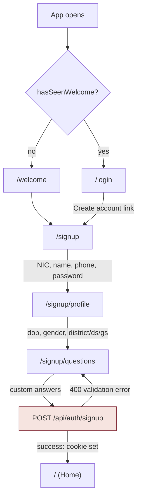
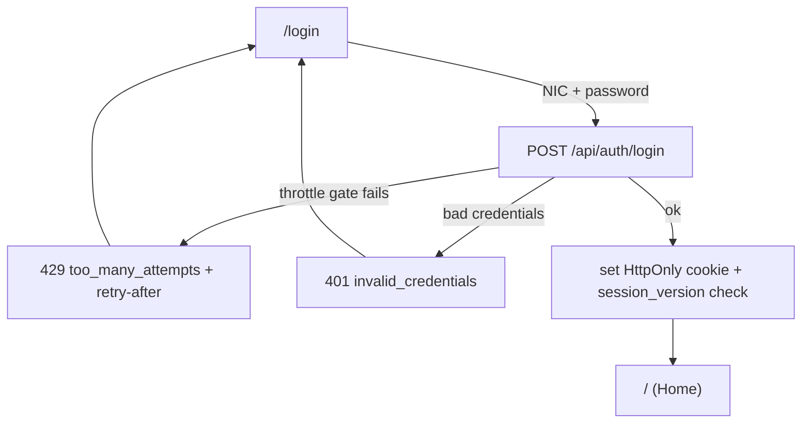
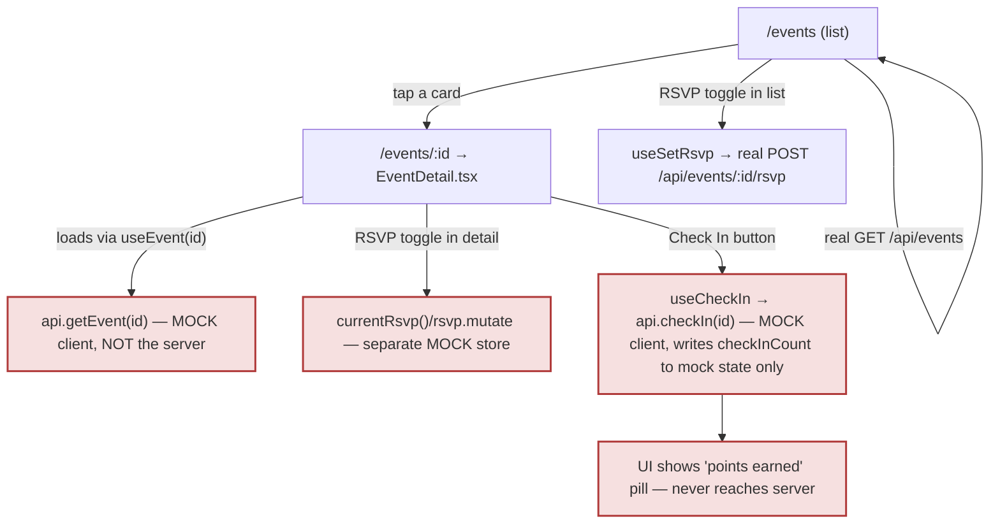
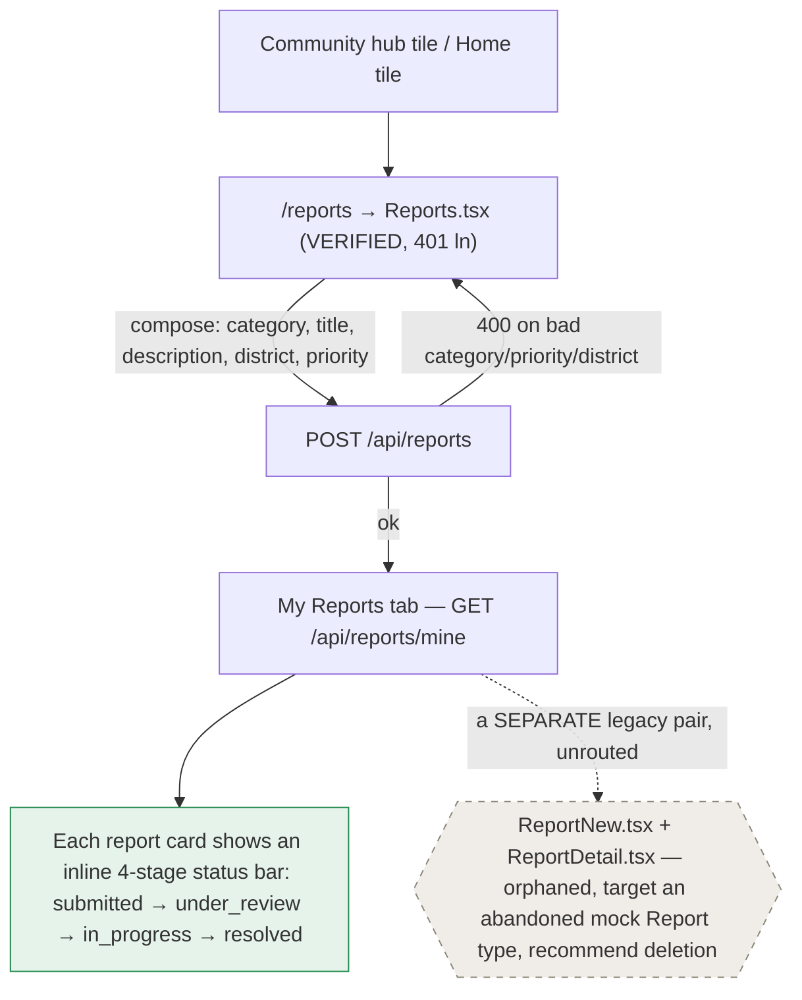
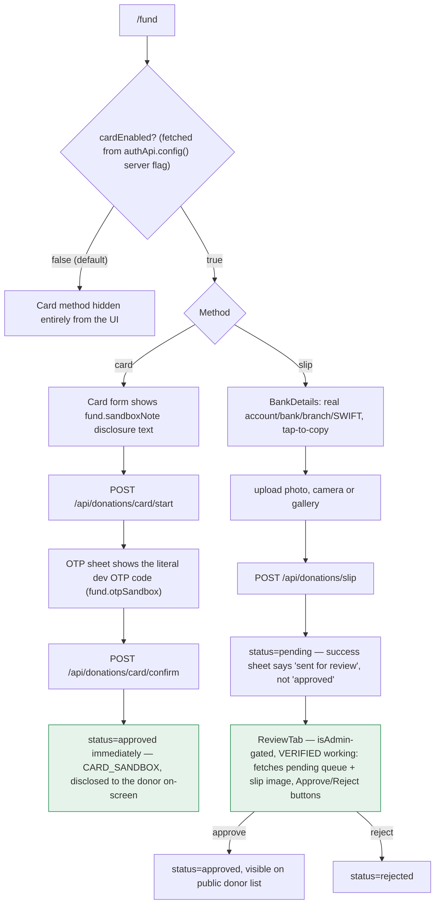
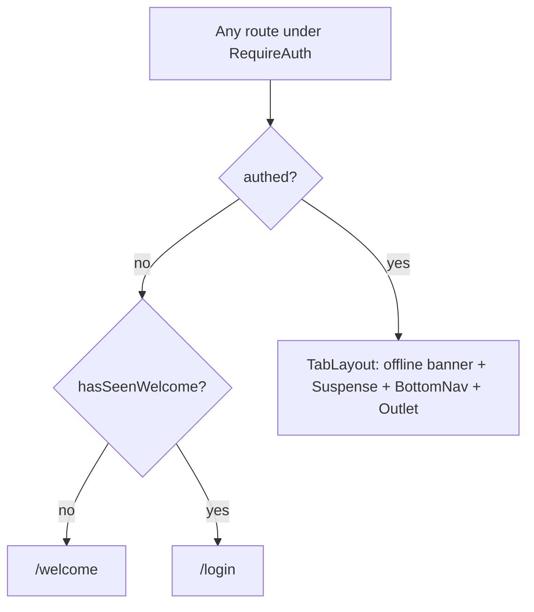

# 04 — User Flow Maps

*பாதைகள் — the paths, drawn from the router and server routes actually found.*

## J1 — Signup to active member


Evidence: `App.tsx:186-197`, `server/src/index.js:260-384` (signup handler span).

## J2 — Login


Evidence: `server/src/index.js:387-421`.
**Open question**: does the Login screen surface the `retry-after` seconds to the user, or does the button just appear to hang? Not inspected — needs direct screen read before claiming good/bad UX.

## J3 — Event RSVP & check-in — **UPDATED: the gap is now a confirmed functional defect, not an open question**


**Follow-up pass finding (DEFECT-03, Critical)**: full reads of both `Events.tsx` and `EventDetail.tsx` confirm the list is genuinely server-backed (`index.js:504-539`) but the detail screen it routes to is entirely mock-backed (`data/mock/client.ts:147-151`) — a full-file grep of `server/src/index.js` for any check-in/points-award route confirms **no such server endpoint exists anywhere**, closing the prior pass's open question: this is a frontend defect (two disconnected data stores for the same event), not a missing/unfound backend route. See 05 DEFECT-03 for the full write-up.

## J4 — Community issue report — **UPDATED: status tracking confirmed working, via a different path than first assumed**


**Follow-up pass finding (revises DEFECT-02)**: the real, live `Reports.tsx` already renders an inline per-report status progress bar (lines 372-398) — so the "track my report's status" promise is substantially met today, just not via a dedicated detail screen. `ReportDetail.tsx`/`ReportNew.tsx` are confirmed orphaned *and* built against a different, abandoned mock data contract (`Report`/`ReportCategory`, not `CommunityReport`) — recommended for deletion rather than reconnection. See 05 DEFECT-02 (revised) and 02's corrected inventory.

## J5 — Party Fund donation — **UPDATED: full 798-line screen read confirms disclosure + working admin review**


Evidence: `server/src/index.js:798-895`, `server/migrations/0006_party_fund.sql`, sandbox comment at `index.js:167-177`, and now `screens/PartyFund.tsx:1-798` (full read, this pass) for every UI node above. **This closes two of the prior pass's open questions**: the sandbox is disclosed, and the admin review screen exists and works. One narrow item remains open: whether `GET /api/donations/pending`/`POST /api/donations/:id/review` independently verify admin role server-side, or only rely on the client hiding the tab (05 UX-21) — not re-confirmed this pass.

## J6 — Language switch

```mermaid
flowchart TD
    A["/profile"] --> B["/language"]
    B -- "pick ta/en/si" --> C[PATCH /api/me language]
    C --> D[local i18n.changeLanguage + savedLang flag set]
    D --> E[UI re-renders in chosen language]
    E -. "future logins" .-> F{App.tsx effect: only re-syncs from server if savedLang() is unset}
```
Evidence: `App.tsx:106-114`, `server/src/index.js:641`.

## Auth gate (cross-cutting)


Evidence: `App.tsx:176-180`.
