# 12 — UX Blueprint & Information Architecture

*ஒருங்கிணைந்த வரைவு — one document pulling 03/04/06/07/11's scattered threads into a single blueprint, plus the two remaining shared files closed out. Every claim below carries the same VERIFIED / INFERRED / UNVERIFIED labelling as 01–11; nothing here re-derives a finding from scratch where a prior doc already established it — see the cross-references.*

---

## 0. What this document is, and isn't

This is a **written specification**: personas, journey diagrams, an information-architecture decision record, a condensed per-screen state table, and a typography/token consolidation guide. It is not a visual mockup. One interactive HTML prototype — the **Home screen, current vs. proposed** — has already been published separately, by a different part of this session, built from 11 §2. This document is the kind of specification that prototype (and any future one) should be built from; it does not claim any other prototype exists.

---

## 1. Personas (consolidated from 03 — not re-derived)

| Persona | Summary | Source |
|---|---|---|
| **P1 — The Member** | Primary user. NIC+password auth, no SMS gate at login. Budget Android phone, Tamil-first reader. | 03 §P1 |
| **P2 — The Prospective Member / Unverified Signup** | Anyone completing `/signup` — no identity check at signup time; can use the full app at `nic_format` verification indefinitely. | 03 §P2 |
| **P3 — The Admin / Coordinator** | Flat `is_admin` flag, no ward/district scoping. Can review donations in-app; cannot review identity verification in-app (no screen exists). | 03 §P3 |
| **P4 — The Anonymous Visitor** | Can hit `GET /api/events`/`GET /api/events/:id` without a session, but no pre-auth screen in the app actually surfaces this — the capability is unused by the UI today. | 03 §P4 |
| **P5 — The Returning-but-Locked-Out Member** | Reaches `/forgot`, which has no corresponding server route — a confirmed dead end (DEFECT-01). | 03 §P5 |

### 1.1 Persona-to-permission matrix (new — VERIFIED from `server/src/index.js`)

No such matrix existed in 03; built here directly from the auth/role guards in the server, cited by file:line.

| Capability | Server guard | P1 Member | P2 Unverified signup | P3 Admin | P4 Anonymous |
|---|---|---|---|---|---|
| Login / session | `requireMember()` pattern, `index.js:387-421` | ✅ | ✅ (post-signup) | ✅ | ❌ |
| Browse events list/detail | `reqContext()` degrades to `memberId: null`, `index.js:492-502` | ✅ | ✅ | ✅ | ✅ (VERIFIED server-side; **UNVERIFIED** any UI route exposes this — see 03 §P4) |
| RSVP to event | real `POST /api/events/:id/rsvp`, requires session (`index.js:504-539` region) | ✅ | ✅ | ✅ | ❌ (INFERRED — not re-confirmed this pass whether RSVP specifically requires a session vs. just degrading `memberId`; flagged for validation) |
| Submit community report | `POST /api/reports`, `index.js:570-593` | ✅ | ✅ | ✅ | ❌ |
| Donate (card sandbox / slip) | `/api/donations/*` | ✅ | ✅ | ✅ | ❌ (INFERRED, not re-tested) |
| **Review pending donations** | `requireAdmin()` → `index.js:713-717`, called at `index.js:873,879,889` | ❌ | ❌ | ✅ | ❌ |
| **Review identity verification** | `requireAdmin()` → `index.js:713-717,726` | ❌ | ❌ | ✅ (server-side capability exists; **no frontend screen anywhere in the repo calls it** — confirmed 02/03/10) | ❌ |
| Edit own profile | `PATCH /api/me`, `index.js:599-648` | ✅ | ✅ | ✅ | ❌ |

`requireAdmin()` itself (`index.js:713-717`) is a two-line wrapper around `requireMember()` plus an `if (!m.is_admin) throw bad('forbidden', 403)` check — a real server-side guard, not merely a hidden UI tab. This directly answers 05's open item **UX-21**: the donation-review and verification-review endpoints **do** independently check `is_admin` server-side; `PartyFund.tsx`'s tab-hiding is a UX convenience layered on top of a real guard, not the only thing standing between a regular member and the review endpoints. **UX-21 is resolved: no unguarded admin route found.**

---

## 2. Current-state journey diagrams (reused from 04; only redrawn where a later pass found a defect)

04 already diagrams J1 (signup), J2 (login), J3 (event RSVP/check-in), J4 (issue report), J5 (donation), J6 (language switch), and the cross-cutting auth gate. Per the task brief, journeys are reused verbatim by reference unless a defect found in 05/06/07 changed the actual flow shape. Below: journeys 04 covers are referenced, not redrawn; journeys 04 does **not** cover (survey, ideas/volunteering, referral/milestones, profile, notifications/offline, admin/coordinator) are drawn fresh here since no prior doc diagrammed them.

### 2.1 Reused as-is from 04 (no redraw — 04's diagram is still accurate)

- **J1 — Signup → active member** (04 §J1): unchanged. No defect found in signup itself across any pass.
- **J2 — Login** (04 §J2): unchanged. UX-01 is a *copy/branching* issue inside the existing flow shape, not a shape change.
- **J6 — Language switch** (04 §J6): unchanged, and confirmed a strength (03/04).

### 2.2 Redrawn because a later pass changed the flow's meaning

**J3 — Event RSVP & check-in.** 04's diagram already shows the mock-vs-server split (DEFECT-03) correctly — reused, not redrawn, but annotated here with the resolution path from 07-A4:

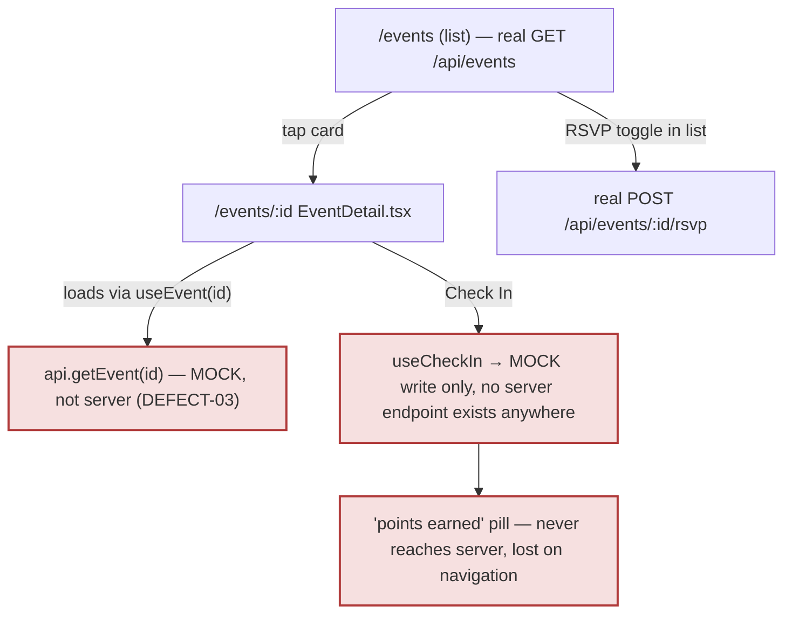
Evidence: 04 §J3, 05 DEFECT-03, 10 item #2.

**J4 — Issue report.** 04's revised diagram (post status-bar discovery) is reused as-is — `Reports.tsx`'s inline 4-stage bar already met the "track my report" promise; `ReportNew`/`ReportDetail` are dead weight recommended for deletion (07-A3), not a flow to redraw toward.

**J5 — Donation.** 04's diagram is reused as-is; this pass's persona-matrix work (§1.1 above) only adds the confirmation that `ReviewTab`'s server-side guard is real, closing UX-21. No shape change.

### 2.3 New diagrams — journeys named in 03/04 but never drawn

**J7 — Survey vote**
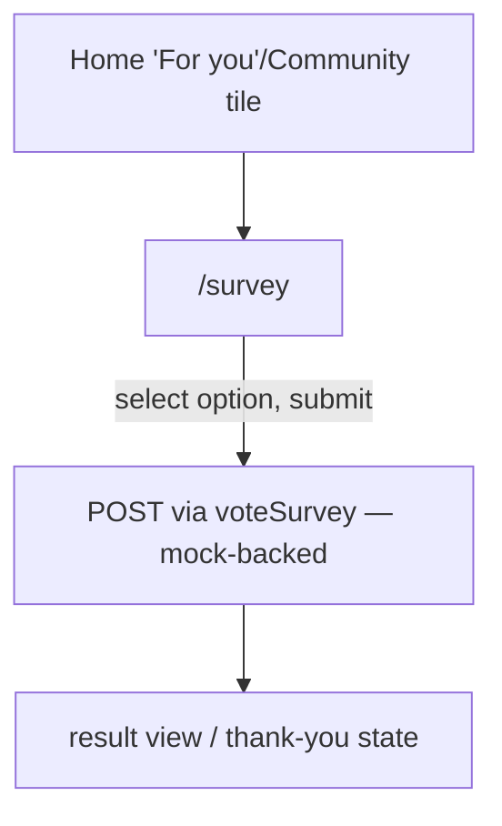
Evidence: 02 S-14, data/api.ts:69. Mock-backed, no defect found.

**J8 — Ideas submission & backing**
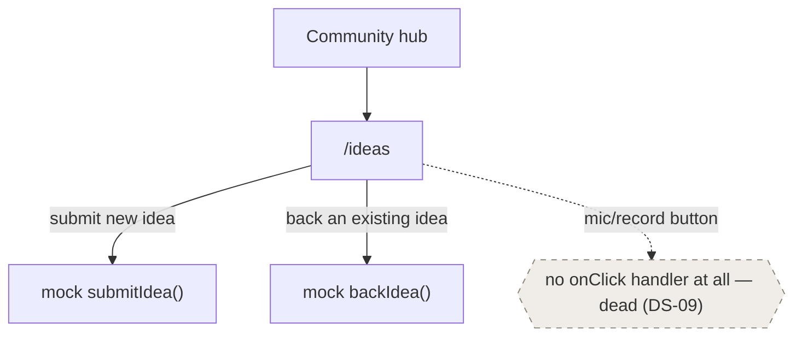
Evidence: 02 S-27, 06 DS-09.

**J9 — Skills / volunteering availability**
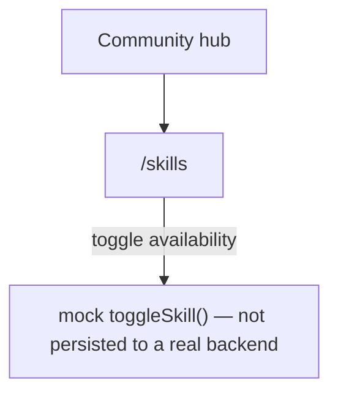
Evidence: 02 S-28, 10 coverage matrix row "Skills".

**J10 — Referral & milestones**
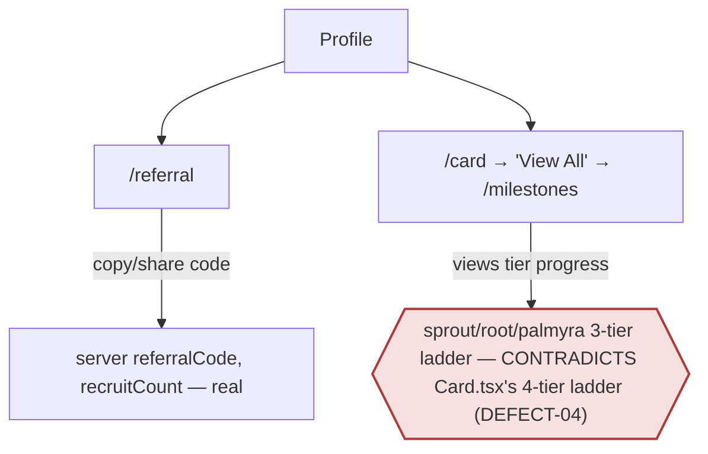
Evidence: 02 S-18/S-19, 05/06 DEFECT-04/DS-03/DS-12.

**J11 — Profile view & edit**
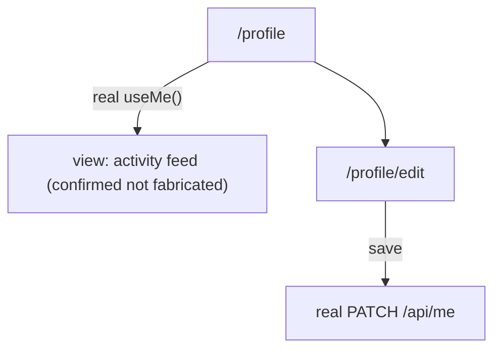
Evidence: 02 S-24/S-25, 10 coverage matrix.

**J12 — Notifications & offline**
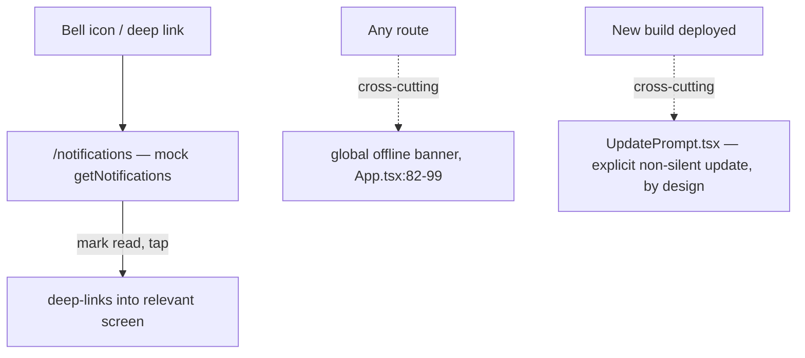
Evidence: 02 S-31, 09 §3 regression checklist, 10 strengths.

**J13 — Admin/coordinator review (donations — supported; verification — not supported)**
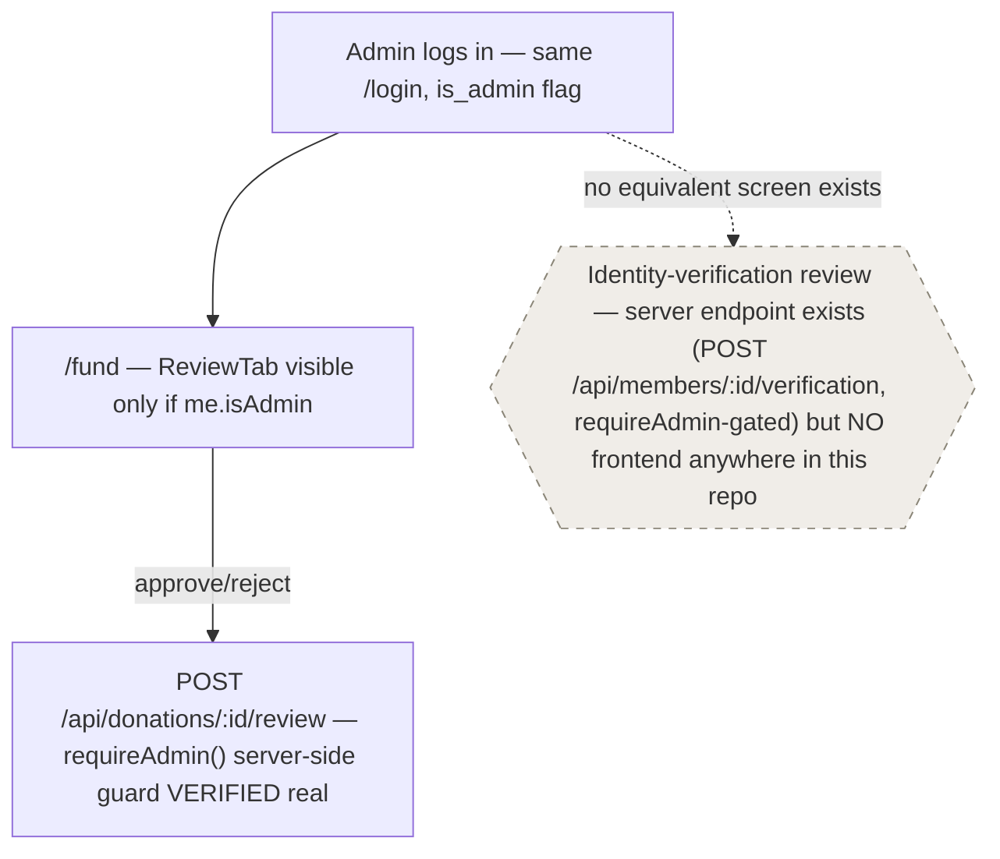
Evidence: §1.1 above, 02 admin capability table, 07-A2.

---

## 3. Proposed-state journey diagrams (only where 07/08/11 actually propose a flow change)

Per the task brief: not every journey gets a proposed-state diagram. Stated plainly, journeys with **no proposed flow change**: J1 (signup), J2's shape (only error-copy branching changes, not the flow graph), J6 (language), J7 (survey), J9 (skills — recommendation is "persist it," not reshape the flow), J10's referral half, J11 (profile), J12 (notifications/offline).

### 3.1 J3 — Event check-in, proposed (07-A4)
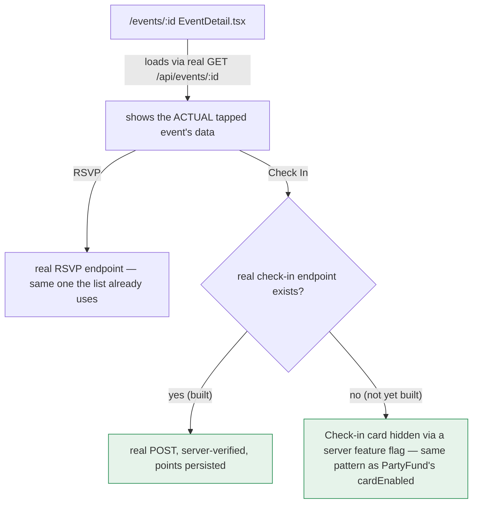

### 3.2 J4 variant — Legacy report pair, proposed (07-A3)
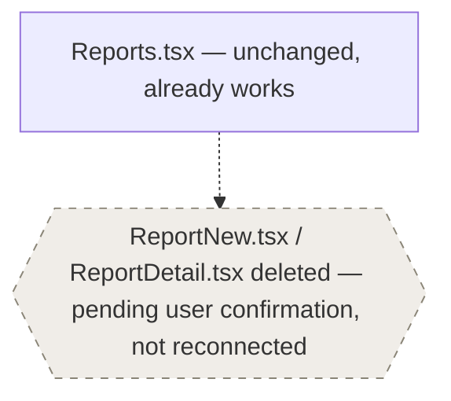

### 3.3 J10 variant — Tier ladder unification, proposed (07-A5)
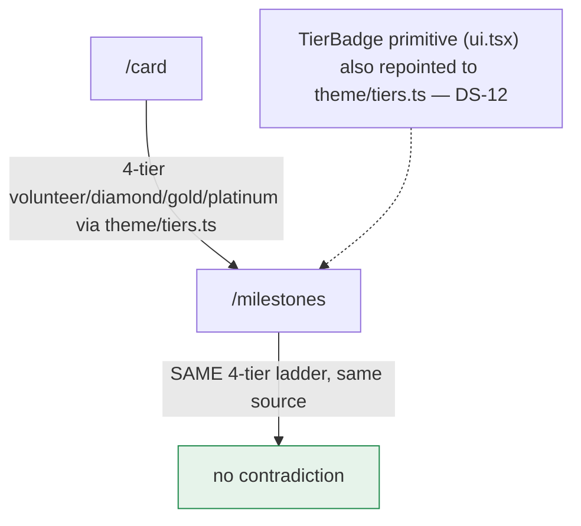

### 3.4 Privacy screen, proposed (07-A6)
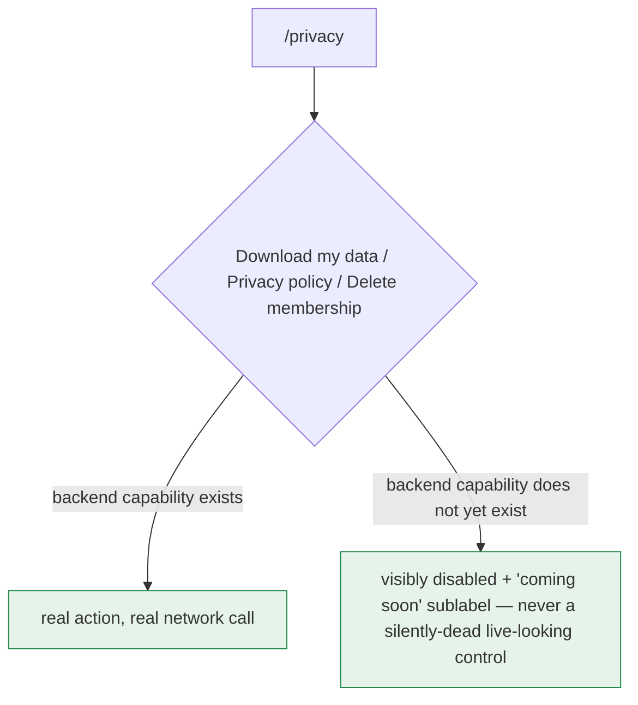

### 3.5 Password recovery, proposed (07-B1)
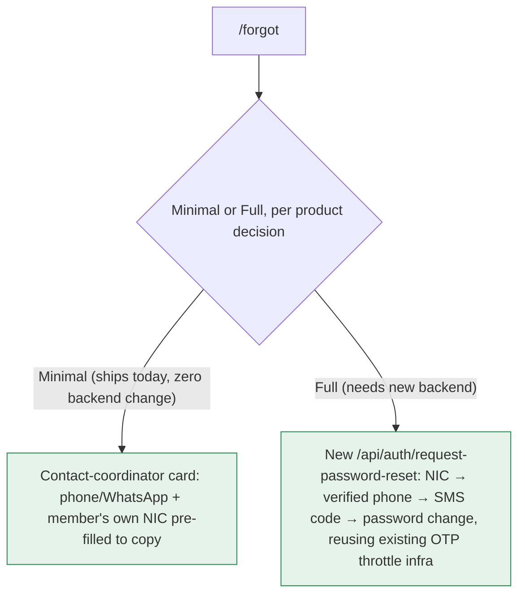

### 3.6 Home "For you," proposed (11 §2.3 — reused by reference, not redrawn — see the published Home prototype and 11 §2 for the full three-option breakdown)

---

## 4. Information architecture — current vs. proposed

### 4.1 Current nav tree (VERIFIED — `BottomNav.tsx:16-39`, `App.tsx:182-236`)

5 bottom tabs. **No center FAB exists in the shipped code today** — this is stated explicitly because the decision section below (§5) treats a FAB as one *candidate* option among several, not something already built and merely undocumented.

```
Bottom Nav (5 tabs, BottomNav.tsx:16-39)
├── Home (/)                         — eager-loaded, default route
├── Events (/events)                 — real server data
├── Card (/card)                     — matches /card AND /milestones
│   └── Milestones (/milestones)     — drill-in via "View All", not a tab itself
├── Community (/community)           — hub; matches 8 sub-routes:
│   ├── MyArea (/area)
│   ├── Reports (/reports)
│   │   └── (orphaned, unrouted: ReportNew.tsx, ReportDetail.tsx)
│   ├── PartyFund (/fund)
│   │   └── ReviewTab (isAdmin-gated, same screen)
│   ├── Ideas (/ideas)
│   ├── Skills (/skills)
│   ├── Courses (/courses)
│   ├── Survey (/survey)
│   └── Gallery (/gallery)
└── Profile (/profile)               — matches 4 sub-routes:
    ├── EditProfile (/profile/edit)
    ├── Referral (/referral)
    ├── Privacy (/privacy)
    ├── Language (/language)
    └── Notifications (/notifications)

Outside the tab layout (RequireAuth gate, App.tsx:176-180):
├── /welcome, /login, /signup, /signup/profile, /signup/questions, /forgot
├── /announcement/:id
└── Legacy, deep-link-only: /onboarding/join, /onboarding/otp, /onboarding/nic, /onboarding/pending
```

Note, carried from 02: PROJECT.md's original prototype describes different tab labels (Home/Events/Card/**Reports**/Profile) — the live app's actual tabs have **Community** in that slot, with Reports nested one level down. This is documentation drift in PROJECT.md, not a code defect, and is listed here only so the proposed IA below isn't mistaken for reverting that drift.

### 4.2 Proposed IA

The **only** structural IA change proposed anywhere in 06/07/11 is Home's "Quick Access" grid → "For you" (07-A1, detailed in 11 §2.3): it changes *what Home's own content panel shows*, not the bottom-nav tree itself. **No prior document proposes changing the 5-tab structure.** The navigation-alternatives decision in §5 below is new to this document — it is not a change already decided in 06/07/11, it is being surfaced explicitly because the task asked for the FAB question to be laid out as a decision rather than silently resolved.

```
Bottom Nav (proposed: UNCHANGED tree — see §5 for why a FAB variant is a decision, not a recommendation baked in here)
├── Home (/) — "For you" panel replaces the static 8-tile grid with 3-4 personalized cards (11 §2.3)
├── Events — unchanged
├── Card (+ Milestones) — unchanged tree; unchanged tier DATA once DEFECT-04 ships
├── Community — unchanged tree; Reports' orphan pair removed once deletion is confirmed (07-A3)
└── Profile — unchanged tree; Privacy's 3 dead buttons become real-or-disabled (07-A6)
```

---

## 5. Navigation-alternatives decision: is a center-FAB model worth adopting?

**This section lays out a decision, not a fait accompli.** The current code has no FAB. The question is whether one should be introduced — most plausibly for "Report Issue," since Home's own Quick Access grid already treats it as a headline action (`Home.tsx:22`, 02).

### Option A — Keep 5 tabs, no FAB (current structure, status quo)
- **Discoverability**: Report Issue stays reachable only via Home's "For you"/Quick-Access panel or the Community hub — two taps from Home's top level today, likely still two taps under the proposed "For you" panel unless it's one of the 3-4 surfaced cards.
- **Visual complexity**: lowest — no new UI pattern, no asymmetric tab bar to get right at 360×640 (the product's stated minimum viewport, 09 §5).
- **Implementation cost**: zero — this is the shipped structure.
- **Consistency with the existing component**: perfect by definition; `BottomNav.tsx`'s data-driven `tabs` array (06 DS-06, a confirmed strength) needs no new rendering branch for a differently-shaped center item.
- **Downside**: Report Issue, arguably the single most time-sensitive civic action in the product, gets no more prominence than Gallery or Courses in the nav itself.

### Option B — 4 tabs + a center FAB that jumps straight to Report Issue
- **Discoverability**: highest for that one action — a FAB is the single most visually prominent element on a bottom nav, and civic-reporting apps commonly use this pattern for exactly this reason (general UX convention — **INFERRED**, not something this codebase or audit measured).
- **Visual complexity**: highest of the three options — `BottomNav.tsx` would need a genuinely new rendering branch (a tab is no longer uniform; the center item is visually raised, differently sized, and not part of the `aria-current`-driven active-state logic the other four use) — this is a real implementation departure from 06 DS-06's "one data array drives everything" strength, not just a style tweak.
- **Implementation cost**: highest — touches `BottomNav.tsx`'s core rendering loop, its CSS (`--shadow-fab` already exists as an unused token in `tokens.css:339` — INFERRED to have been prepared for exactly this, **NEEDS VALIDATION** against git history, which this audit cannot access), and likely needs its own focus-order/accessibility pass since a raised FAB breaks the simple left-to-right tab semantics screen readers expect from `role="tablist"`-adjacent patterns.
- **Which tab absorbs the fifth slot?** Two sub-options, neither free: collapse Card and Milestones under one tab (already the case today, so no loss) and demote something else — but every remaining tab (Home, Events, Community, Profile) is a top-level destination with real daily traffic per 02/03; none is an obviously safe demotion candidate without a usage-data decision this audit cannot make from code alone (**UNVERIFIED** — needs real usage analytics, not available here).
- **Downside**: the prominence gain for Report Issue is paid for by reduced prominence for whichever existing tab gets folded in, and by a one-time implementation cost that touches a component 06 specifically flagged as a "keep this pattern" strength.

### Option C — Keep 5 tabs, no FAB, but promote Report Issue inside Home's "For you" panel instead (hybrid)
- **Discoverability**: a middle ground — not as prominent as a literal FAB, but more prominent than today, since 11 §2.3's proposed "For you" panel already is designed to show live personal state (e.g. "your last report: under review") rather than a generic menu tile. A first-time or urgent report could be made one of the panel's always-shown slots rather than competing with 7 other static tiles.
- **Visual complexity**: lowest of the three real options — this is already inside 11's proposed Home redesign; no new nav-bar rendering branch needed at all.
- **Implementation cost**: lowest — it's a content/data decision within a redesign already scoped (11 §2.3), not a new component.
- **Consistency with existing component**: unaffected — `BottomNav.tsx` doesn't change at all.
- **Downside**: it doesn't solve the problem for a member who is *not* currently on Home (e.g. mid-Events-browsing) and wants to report something immediately — a FAB's real advantage is being reachable from anywhere persistent navigation renders, which Option C does not provide.

### Recommendation (explicitly a recommendation, not a decision already made)

**Option C**, with Option B kept open as a later escalation if usage data (not available to this audit) shows Report Issue is being under-used specifically because it isn't persistently reachable. Reasoning: Option B's implementation cost and accessibility-rework burden are real and immediate; Option C captures most of the discoverability gain using work 11 already scoped, at a fraction of the cost, and does not put 06 DS-06's "single data array drives the nav" strength at risk. This recommendation should be revisited once the team can observe how often members navigate to `/reports` from each entry point (Home grid vs. Community hub) — that data would directly validate or overturn it, and this audit has no access to it (**UNVERIFIED**, by design — this is a code-reading audit, not a usage-analytics one).

---

## 6. Screen-by-screen state coverage (condensed from 11 — not duplicated at full length)

Full per-screen layout detail lives in 11. This table's purpose is narrower: per screen, which interaction states (loading / empty / error / validation / success / offline) are **confirmed present in code** vs. **missing/unverified**, in one scan.

| Screen | Loading | Empty | Error | Validation | Success | Offline-aware |
|---|---|---|---|---|---|---|
| Login | ✅ `busy` state | n/a | ✅ `role="alert"`, but UX-01 collapses codes | ✅ NIC format, post-touch | ✅ redirect | global banner only |
| Forgot | n/a | n/a | n/a | n/a | ❌ **fabricated** (DEFECT-01) | global banner only |
| SignUp/Profile/Questions | **not inspected this pass for spinner** (04 §J1 flags as unverified) | n/a | ✅ per-error-code (05) | ✅ strong | ✅ redirect to Home | global banner only |
| Home | ✅ `QueryBoundary` | ✅ events; ❌ none for Local Updates (11 §2.1 pt.6) | ✅ via `QueryBoundary` | n/a | n/a | global banner |
| Events | ✅ (server-backed) | **not re-confirmed this pass** | ✅ via `QueryBoundary` | n/a | ✅ RSVP toggle | global banner |
| EventDetail | ✅ (but against mock data — DEFECT-03) | n/a | **mock, so error path untested against real failure** | n/a | ❌ fake check-in success | global banner |
| Reports | ✅ | **not re-confirmed** | ✅ 400 validation surfaced (04 §J4) | ✅ category/priority/district enums | ✅ real POST, inline status bar | global banner + outbox sync (10 strengths) |
| ReportNew/ReportDetail | n/a (orphaned) | n/a | n/a | n/a | n/a | n/a |
| Card | ✅ | n/a | **not re-confirmed** | n/a | n/a | global banner |
| Milestones | ✅ | n/a | **not re-confirmed** | n/a | n/a | global banner; **tier-ladder contradiction, DEFECT-04** |
| Referral | ✅ | n/a | **not re-confirmed** | n/a | ✅ copy/share | global banner |
| PartyFund | ✅ | n/a (donor list can be empty — **not confirmed handled**) | **not re-confirmed for network failure mid-flow** | ✅ OTP, slip upload | ✅ honest (card=sandbox-disclosed, slip=pending-not-approved) | global banner |
| Profile | ✅ `useMe` | n/a | **not re-confirmed** | n/a | n/a | global banner |
| EditProfile | n/a | n/a | **not re-confirmed** | **not re-confirmed field-level** | ✅ real PATCH | global banner |
| Courses | ✅ | **not re-confirmed** | **not re-confirmed** | n/a | n/a | global banner |
| Ideas | ✅ | **not re-confirmed** | **not re-confirmed** | n/a | ✅ submit/back | global banner; **dead mic button (DS-09)** |
| Skills | ✅ | **not re-confirmed** | **not re-confirmed** | n/a | ⚠️ toggle not persisted server-side | global banner; **sub-44px touch target (UX-23)** |
| Privacy | n/a | n/a | n/a | n/a | ✅ toggles work; **3 dead buttons (DEFECT-05)** | global banner; **sub-44px toggle target (UX-23)** |
| Notifications | ✅ | **not re-confirmed** | **not re-confirmed** | n/a | ✅ mark-read | global banner |
| Gallery | n/a (static data) | n/a | n/a | n/a | n/a | global banner |
| Community | ✅ | **not re-confirmed** | **not re-confirmed** | n/a | n/a | global banner |
| MyArea | ✅ | **not re-confirmed** | **not re-confirmed** | n/a | n/a | global banner |
| Language | n/a | n/a | **not re-confirmed** | n/a | ✅ real PATCH | global banner |
| Announcement | n/a | n/a | n/a | n/a | ⚠️ local-only "confirm attendance" (same pattern as DEFECT-03, lower severity) | global banner |
| Survey | n/a | n/a | **not re-confirmed** | n/a | ✅ vote mutation calls through | global banner |
| Legacy Join/Pending | n/a | n/a | n/a | n/a | ⚠️ `Pending.tsx` bypasses its own review premise (DEFECT-06) | global banner |
| Legacy Otp/Nic | ✅ (Otp) | n/a | ✅ (Otp) | ✅ digit-count gating (Otp) | ✅ (Otp, real call) / ❌ (Nic — fake capture, DEFECT-07) | global banner |

"**not re-confirmed**" means: no prior pass's notes explicitly called out that state for that screen one way or the other — it is an honest gap in the audit's own notes, not a claim that the state is missing in the app. Closing these would require either a fresh targeted re-read of each screen for just that state, or a live/browser pass (which this audit cannot perform, per its ground rules).

---

## 7. Tamil-first visual design system — consolidated

### 7.1 Font stack reasoning (from `tokens.ts`'s own comment, cited in 11 §1.2)
`font.ta: 'Inter', 'Noto Sans Tamil', sans-serif` lists Inter first deliberately — the code comment explains this fixes a prior bug where listing Noto first made **English** text render in the Tamil font. Per-glyph CSS fallback still routes actual Tamil characters to Noto Sans Tamil when Inter lacks coverage, so this ordering is sound, not an oversight (VERIFIED, 11 §1.2).

### 7.2 Three parallel token systems — now fully reconciled across this audit
1. **Light "logo-navy" set** (`tokens.css` block 1, lines 21-140/148-220) — **dead code**, overridden by cascade, confirmed this pass (06 DS-10). Not merely legacy — provably unreachable.
2. **Light "AUTHORITATIVE THEME" set** (`tokens.css` block 2, lines 239-342/344-398) — the live system every screen actually renders with.
3. **`authC` dark/green set** (`auth/parts.tsx`, scoped to the Login/SignUp family only — confirmed in 05's prior pass) — live, but a separate object from the above two.

**Resolution proposed (06 §"Recommended token system direction" + 11 §1.1, reconciled)**: delete block 1 outright (not just deprioritize — it is dead); keep block 2 as the single light/dark source; fold `authC` into the same token object as a themed slice ("auth screens render in dark mode") rather than a parallel object. The *brand* decision of whether navy or green becomes the one true `color.primary` across both member-app and auth contexts remains explicitly open for the user (11 §1.1) — this document does not resolve it either.

### 7.3 Line-height and truncation risk (from 11 §1.2, confirmed, not re-derived)
No Tamil-specific line-height or letter-spacing override exists anywhere in the token files — every inline style applies the same line-height to Tamil and English runs of the same role. Tamil's taller vowel-sign stacking typically wants 10-15% more line-height than Latin at the same point size. All truncation patterns found by direct read use ellipsis/line-clamp (never fixed-width hard crops), which is the right pattern to preserve — Tamil clips sooner than English at the same box width, so a fixed-height single-line box would be the wrong fix.

### 7.4 Concrete Tamil string-length guidance (new — extends 11 §1.2's general warning with per-component numbers)

Tamil runs ~20-40% longer than English for equivalent meaning (11 §1.2, general UX knowledge — **INFERRED** as a typical range, not measured against this app's actual production copy in a browser). Applied per component type found in this codebase:

| Component | Current sizing (VERIFIED from code) | Tamil inflation risk | Recommendation |
|---|---|---|---|
| `Button` (`ui.tsx:35-48`) | `height: control.hSm` (52px per `tokens.css`), padding `0 20px`, no `min-width` | Longer Tamil button labels (e.g. a two-word CTA) can push `justify-content:center` content tight against the 20px padding at narrow widths | Keep height fixed (52px is already generous); do not fix a `width` — let `fullWidth` or intrinsic content width continue to govern, and test the single longest real Tamil CTA string in the app (not a placeholder) at 360px viewport |
| `Chip` (`ui.tsx:187-210`) | `height: 44px` fixed, `padding: 0 16px`, no fixed width | Chips are used for category filters (e.g. Reports composer) — Tamil category names risk two-line wrap inside a pill shape, which looks broken (pills aren't designed for wrapped text) | Set `white-space: nowrap` explicitly (confirm it's already implied by flex/inline-flex — **NEEDS VALIDATION** in a browser) and allow the chip row to scroll horizontally rather than wrap, matching the existing `flex: 'none'` on each chip |
| `BottomNav` labels (`BottomNav.tsx:16-39`) | No explicit width constraint found; five tabs share the row width equally (INFERRED from flex layout, CSS not opened) | Nav labels are the single highest-exposure Tamil string in the app (seen on every screen) — "சமூகம்" (Community) and "சுயவிவரம்" (Profile) are visually longer than their English equivalents | Verify at 360px viewport that no label wraps to two lines (a wrapped nav label looks broken and may shift the icon); if any does, reduce font-size specifically for the nav label role rather than shortening the translation |
| Card titles (e.g. announcement/report cards) | `WebkitLineClamp: 2` confirmed (`Home.tsx:198`, 11 §1.2) | Low risk — already clamp-safe | No change needed; confirmed strength |
| Member name display | `overflow:hidden;textOverflow:ellipsis;whiteSpace:nowrap` (`Home.tsx:104`) | Low risk — already ellipsis-safe | No change needed; confirmed strength |

**Minimum touch-target recommendation (ties to DS-11/UX-23 above)**: standardize every interactive control — including `Toggle`, which currently fails this — at a minimum 44×44px hit area, matching the `--touch-min` token that `tokens.css` already declares but `Toggle` does not honor.

**Minimum line-height recommendation**: adopt 11 §1.2's proposed Tamil line-height column (1.3 for display, 1.4 for titles, 1.65-1.75 for body, 1.2 for labels) as the default for any string resolving through `font.ta`, rather than sharing the Latin line-height value as today.

---

## 8. Note on interactive prototypes

One interactive HTML prototype — the **Home screen, current state vs. proposed state** — has already been built and published separately within this session, by a different part of the work than this audit. It was built from 11 §2 (the most detailed, "load-bearing" section of the visual-redesign spec). This document, 12, is the **written specification** other prototypes would be built from if the team chooses to extend prototyping to additional screens (e.g. Events/EventDetail once DEFECT-03 is resolved, or Privacy once DEFECT-05 is resolved) — no additional prototype beyond the published Home one exists today, and none should be assumed to exist from anything written in 01-12.

---

## 9. Validation and approval checklist — extends 09, does not duplicate it

09 already has a full manual-QA checklist per defect (DEFECT-01 through 07), a regression checklist, an accessibility checklist, and a responsive checklist. The items below are **new**, specific to decisions this document (12) introduces that 09 could not have anticipated.

### 9.1 FAB decision (§5) — checklist for once the user picks an option
- [ ] Record which option (A/B/C) was chosen, and by whom, with a date — this audit deliberately left it open; it must not be silently implemented as "the plan" without an explicit choice logged.
- [ ] If **Option B** is chosen: confirm `BottomNav.tsx`'s `tabs` array (06 DS-06, currently a clean data-driven strength) still has a single source of truth after adding the asymmetric center item — do not let the FAB become a second, parallel nav-definition.
- [ ] If **Option B** is chosen: confirm keyboard/screen-reader focus order across the 5-item row is still logical with a visually-raised center item (this is the specific accessibility risk named in §5, not yet tested).
- [ ] If **Option B** is chosen: confirm which existing tab's destinations absorb into the remaining 4 slots, and that none of its 8-9 sub-routes (per §4.1's match arrays) becomes unreachable.
- [ ] If **Option C** is chosen: confirm the "For you" panel (11 §2.3) actually surfaces Report Issue as one of its always-shown slots, not just a possible rotation item, if discoverability for that specific action is the goal.

### 9.2 DEFECT-03/06/07 fixes — approval-specific checks (09 already has the QA steps; these are sign-off gates)
- [ ] **DEFECT-03** (fake check-in): product sign-off on which remediation path ships — real check-in endpoint built, or check-in UI hidden via feature flag (07-A4) — before any code change is merged, since these are materially different scopes of work.
- [ ] **DEFECT-06** (`Pending.tsx` bypass): product sign-off on whether `/onboarding/*` is being sunset or kept (07 §D, still an open question per 10 item #7) — the fix differs materially depending on the answer (remove the screen vs. make its action honest).
- [ ] **DEFECT-07** (`Nic.tsx` fake photo capture): confirm with the user whether this route is reachable by any real deep link today before scoping the fix's urgency (10's open question #10) — sign-off gate, not just a QA step.

### 9.3 Tamil typography checks on real devices (new — 09's accessibility section has a 200%-font-scale item but nothing Tamil-specific beyond that)
- [ ] On a real budget Android device (not a desktop browser emulation), confirm `BottomNav` labels for Community/Profile do not wrap at 360px width.
- [ ] Confirm the longest real (not placeholder) Tamil string for each component type in §7.4's table renders without clipping or pill-wrap.
- [ ] Confirm Noto Sans Tamil actually loads (network tab) rather than silently falling through to a system fallback on a low-end device with constrained font-loading.
- [ ] Re-test 09's existing 200% OS font-scale item specifically with the Tamil locale active, not just English — 09's item did not specify which locale.

### 9.4 Regression coverage for touched screens (ties to 09 §3's existing checklist — adds the items 09 could not have listed since they come from this document's own findings)
- [ ] Any change to `Toggle` (DS-11/UX-23 fix) is regression-checked on both screens that use it today (Privacy, Skills) in both light and dark mode.
- [ ] Any change to `TierBadge` (DS-12/UX-24 fix) is regression-checked wherever it's rendered (confirm the full call-site list via `grep -rn "TierBadge" app/src` before sign-off — not exhaustively enumerated in this audit).
- [ ] Deletion of `tokens.css` block 1 (DS-10 fix) is regression-checked across **every** screen in one light-mode and one dark-mode pass, since it is, by definition, currently-dead code — the risk is not that removing it breaks anything (it can't, nothing reads it), but that someone mistakenly re-verifies against the wrong block during the same change and introduces a real regression by editing block 2 incorrectly while "cleaning up."

---

## 10. Closing note

This document closes the file-coverage gap named honestly in 02/10 (both shared files now read in full — see those docs' updated coverage sections) and consolidates 03/04/06/07/11 into one blueprint without re-deriving any finding from scratch. The one deliberately-left-open decision in this entire audit is §5's FAB question — stated as a recommendation (Option C), not a decision, per the task's explicit instruction not to silently pick one.
